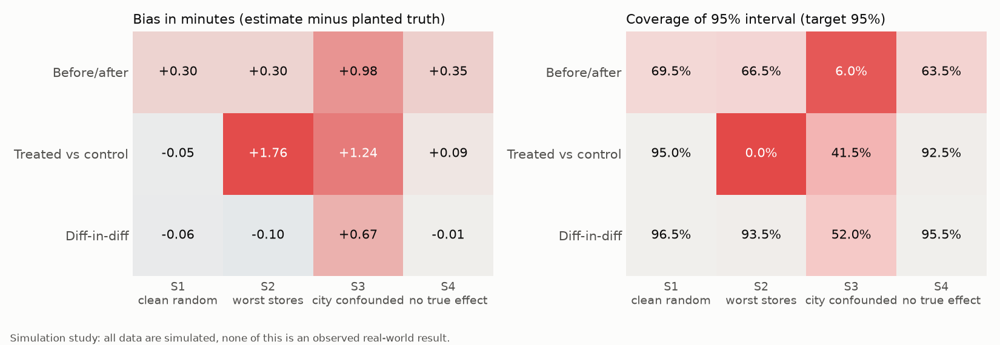

# Experiment & Pilot Evaluation Framework (simulation study)

**All data in this project are simulated. No number here is an observed result from a real business.** Operational pilots run per store, muddied by rain, festivals and hand-picked stores, and real data never reveals the true effect. So this simulator plants a known effect and known traps in a 30-store, 20-week dark-store pilot and a 100,000-user A/B test, then scores whether each evaluation method recovers the truth. It ends with a pre-registered scale / iterate / kill decision, a tracker, and a rollout and stop-loss plan.

Built 2026-11-01. Stack: Python, DuckDB SQL, statsmodels, openpyxl.

## Key findings (simulated; every number is in [`docs/RESULTS.md`](docs/RESULTS.md))

1. **Difference-in-differences recovered the planted effect:** estimate -1.19 min against a planted -1.2, 95% interval -1.87 to -0.51. The pre-registered rubric says SCALE, narrowly.
2. **Naive methods misled.** Before/after understated the effect by 0.30 min on average in the clean scenario, and declared an effect in 36.5% of runs when none existed (DiD: 4.5%). Treated vs control, with hand-picked worst stores, showed the pilot as *harmful* on average (bias +1.76 min, 95% interval coverage 0.0%).
3. **DiD is not magic.** When a city-level shock hit treated stores more, DiD was off by +0.67 min and coverage fell to 52.0%, and the pre-trend check caught only 5.5% of those runs, since the shock came after the start.
4. **Ordinary standard errors were 2.71 times too small** on store-days, with a design effect of 20.6. Daily peeking raised false positives from 4.3% to 21.4%.
5. **A primary-metric win did not ship:** the A/B variant lifted conversion +0.62 pp but breached the refund guardrail. A planted assignment bug was caught by the sample ratio check before any metric was read.

## Methods by scenarios (200 replications each)

Bias in minutes, then 95% interval coverage. Planted effect -1.2 min (0 in S4).

| Method | S1 clean random | S2 worst stores | S3 city confounded | S4 no true effect |
|---|---|---|---|---|
| Before/after | +0.30, 69.5% | +0.30, 66.5% | +0.98, 6.0% | +0.35, 63.5% |
| Treated vs control | -0.05, 95.0% | +1.76, 0.0% | +1.24, 41.5% | +0.09, 92.5% |
| Difference-in-differences | -0.06, 96.5% | -0.10, 93.5% | +0.67, 52.0% | -0.01, 95.5% |

## Reproducibility

The build script and dependency list are kept outside this repository, so it cannot be rebuilt from a fresh clone as published. The full report is at [`outputs/report.html`](outputs/report.html).

## Where things are

| Path | What |
|---|---|
| `simulator/` | Writes `data/observed/` and `data/truth/` |
| `sql/` | Staging, quality checks, baselines, scorecard, anomaly flags, panel |
| `analysis/` | Estimators; reads observed data only (enforced by `tests/test_firewall.py`) |
| `validate/` | The only code that sees the truth; replications and cross-checks |
| `outputs/pilot_tracker.xlsx` | Live-formula tracking workbook |

## Limitations

- **Conclusions depend on the simulator's assumptions.** This shows how methods behave in a world I specified. It does not show that pre-staging works, or that real pilots behave this way.
- I wrote both the pre-registration and the simulator, so the pre-registration limits later changes but is not blind.
- Effects are additive and equal across stores. No store-to-store spillover, and no fading of the effect.
- The 0.5-minute minimum worthwhile effect is an assumed break-even, not a measured cost, and it decides the outcome.
- Anomaly flags are weak on precision: only 7.0% of "unexplained" flags were real planted incidents. A streak rule did not fix it (31.6% precision, 25.0% recall).
- The tracker's formulas were recalculated by an independent library, but the file has not been opened in Excel or Google Sheets.
